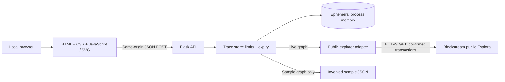

# Technical Design Document

## Scope

BTC Flow Tracer Community v1 provides a limited, outgoing Bitcoin address graph.
The implementation is standalone: one Flask app, one public explorer adapter,
and a plain JavaScript/SVG interface. Only the home page, trace creation, and
trace expansion endpoints exist. The UI contains an address field, trace button,
synthetic-sample button, and an expandable graph.

Rules, classifications, risk intelligence, proprietary datasets, confidential
integrations, AI, clustering, case management, reports, and exports are outside
this codebase. They are not hidden behind flags or shipped as disabled modules.

## Architecture



| File | Responsibility |
| --- | --- |
| `app.py` | Local entry point; reads `HOST` and `PORT` |
| `community/__init__.py` | HTTP routes, input validation, error responses, headers |
| `community/tracing.py` | In-memory graph state, immutable expansion limits, expiry |
| `community/explorer.py` | Read-only public provider and connection selection |
| `templates/index.html` | Minimal application shell |
| `static/app.js` | Requests, SVG layout, keyboard/click expansion |
| `static/style.css` | Responsive graph and form styling |
| `samples/transactions.json` | Synthetic, offline transaction-shaped data |
| `tests/test_app.py` | Offline API, limits, error and provider regression tests |

## Request lifecycle

```mermaid
sequenceDiagram
    actor User
    participant UI as Browser
    participant API as Flask
    participant Store as In-memory trace store
    participant Provider as Public Esplora
    User->>UI: Enter address and trace
    UI->>API: POST /api/trace {address}
    API->>API: Validate JSON and address syntax
    API->>Store: Create bounded graph
    Store->>Provider: GET /address/:address/txs/chain
    Provider-->>Store: Up to 25 confirmed transactions
    Store->>Store: Select up to 3 output connections
    Store-->>UI: Trace ID, nodes, edges
    User->>UI: Select unexpanded node
    UI->>API: POST /api/expand {trace_id, address}
    API->>Store: Validate graph, expiry and membership
    Store->>Provider: GET /address/:address/txs/chain
    Provider-->>Store: Recent confirmed transactions
    Store->>Store: Add up to 2 output connections; mark expanded
    Store-->>UI: Updated graph
```

Sample requests take the same bounded selection path but read the synthetic JSON
instead of calling the provider. A live failure returns an error; it never falls
back to synthetic data.

## API contract

All request bodies are JSON objects; unknown fields are rejected. Bodies are
limited to 2 KiB. APIs are POST-only; addresses are not included in local URLs.

| Endpoint | Body | Behavior |
| --- | --- | --- |
| `GET /` | None | Application shell |
| `POST /api/trace` | `{"address":"<mainnet address>"}` | New live trace; max 3 edges |
| `POST /api/trace` | `{"sample":true}` | New synthetic trace from `demo-root` |
| `POST /api/expand` | `{"trace_id":"<opaque ID>","address":"<visible address>"}` | Expand once; max 2 edges |

Successful responses include `trace_id`, `root`, `source` (`blockstream` or
`synthetic`), `nodes`, `edges`, `limited`, and `at_limit`.

- Nodes: `id`, discovery `depth`, `expanded`, and `expandable`.
- Edges: `source`, `target`, `txid`, `vout` (output index), `value_sats` (integer).
- `limited` indicates that the latest expansion omitted eligible connections.
  It does not assert that all historical transactions have been examined.
- `at_limit` means the graph's global node or edge cap is reached.
- `trace_id` is an unpredictable, process-local graph handle. It is not a user
  login or a persistent credential. Possession allows expansion of that graph.

Errors use `{"error":"message"}`. Status codes include 400 for invalid input,
404 for absent/expired graphs, 409 for repeat expansion or a full graph,
413 for oversized requests, 415 for non-JSON bodies, 502 for explorer failures,
and 503 when the active-graph capacity is full. Removed features return 404.

## Limits and graph semantics

| Bound | Value |
| --- | --- |
| Initial address expansion | 3 output connections |
| Each later address expansion | 2 output connections |
| Maximum nodes / edges per graph | 60 / 90 |
| Active graphs per process | 50 |
| Graph lifetime | 900 seconds from creation |
| Transactions examined per address | One page, up to 25 confirmed |
| Provider connect / read-idle timeout | 4 / 10 seconds |
| Maximum provider response body | 4 MB |

These are backend constants, not user-adjustable configuration. A root address
is marked expanded after its initial fetch. Only discovered addresses can be
expanded, once per graph. Repeating a request cannot request additional pages.
Creating a separate graph is allowed; these are per-graph limits, not a paid-tier
enforcement or per-person quota.

Selection follows newest-first transaction order and original output order.
Only transactions containing the selected address in an input qualify. Outputs
without an address, to the same address, or with invalid values are omitted.
Duplicate `(txid, output index)` records within an expansion are skipped.
Multiple outputs to one address remain separate edges. Previously seen addresses
remain one node, allowing cycles. Node depth is its first-discovery depth.

The full output value is shown for context. The algorithm does not allocate
that value to a particular input, classify change, follow specific UTXOs, infer
ownership, or guarantee chronological continuation between adjacent edges.
Amounts should not be summed across graph edges as distinct funds.

## Data, isolation and concurrency

There is no database, disk cache, saved investigation, localStorage, cookie,
telemetry, CDN, or key-based integration. Graphs are held in RAM and removed
lazily on the next graph operation after expiry. Restarting the process clears
them immediately. Sample labels and transaction IDs are entirely invented.

One lock serializes store operations, including provider calls, so concurrent
expansions cannot race past limits or duplicate an expansion. This deliberately
simple local design can block other requests behind a slow provider. Run one
process; multiple workers would have unrelated stores. HTTP read timeouts are
idle timeouts, not a guaranteed total end-to-end deadline.

## Security and publication boundary

- Only a fixed public HTTPS provider is contacted, with redirects disabled.
  Address syntax is constrained before use in a URL; Esplora validates checksums.
- All user/provider strings are inserted with DOM `textContent`, not HTML.
- Browser scripts, styles, and requests are same-origin under a restrictive CSP.
  API responses are not cached; no cross-origin API permissions are enabled.
- `.env`, keys, virtual environments, logs, and bytecode are excluded from Git.
- A fresh Git history contains only this community implementation, documentation,
  tests, and synthetic samples. No legacy repository objects are published.
- Public data queries reveal queried addresses to Blockstream. Graph handles
  should not be shared if the corresponding exploratory state is private.
- This is a localhost tool. Public deployment requires authentication, rate
  limiting, request scheduling, TLS, and a production serving strategy, none of
  which are part of this v1.

## Verification

Run `python -m unittest discover -s tests -v`. Tests stub live responses and do
not contact public services. They exercise graph limits and bypass attempts,
expiry, capacity, cycles, retryable failures, malformed data, request-size limits,
privacy headers, and the exact route inventory.

Manual UI check: start the app, select **Try a sample**, verify 3 edges from
`demo-root`, select `demo-alice`, and verify exactly 2 new edges. Repeated
expansion must not add more. Check keyboard expansion and a narrow viewport.

Provider contract: [official Esplora API documentation](https://github.com/Blockstream/esplora/blob/master/API.md).
